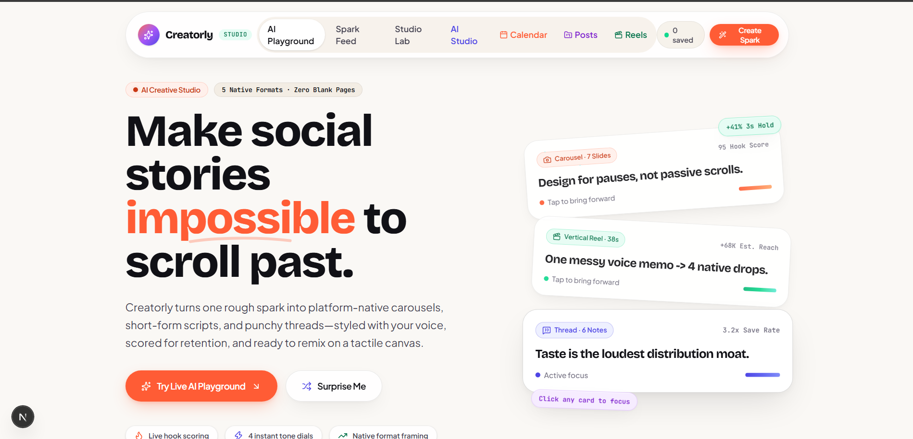
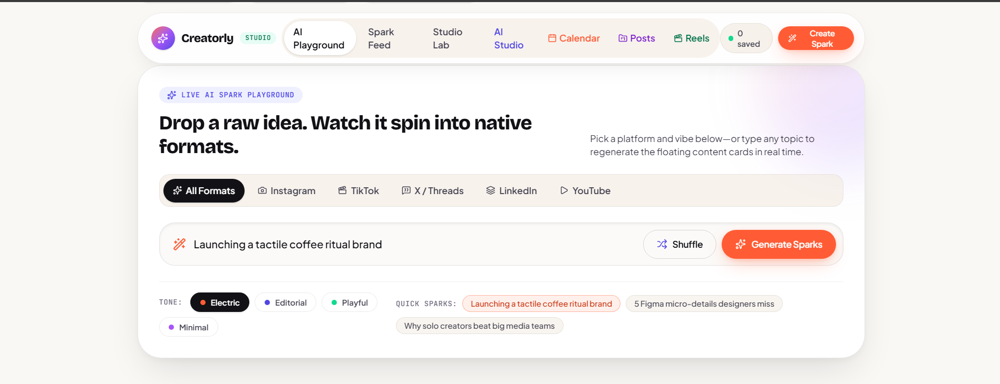
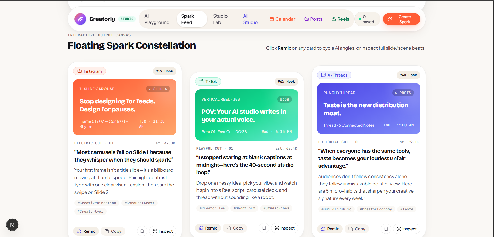
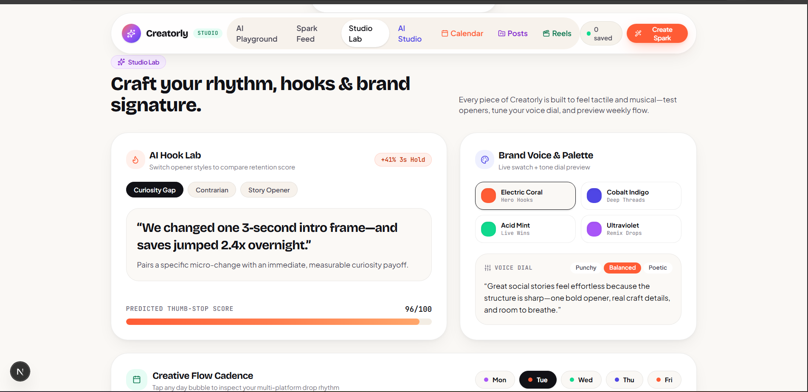
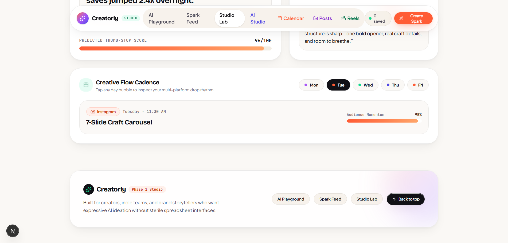
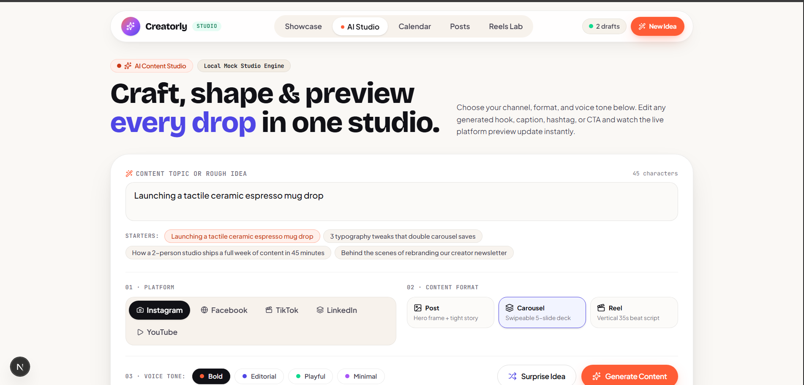
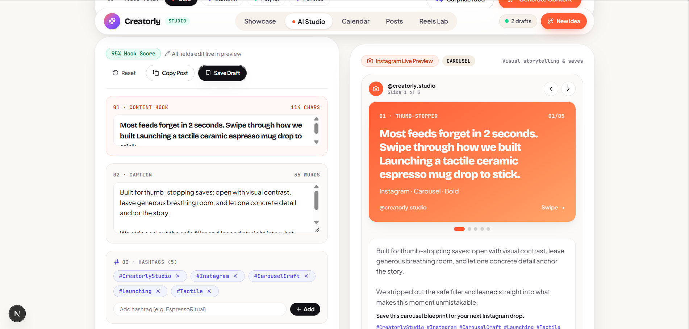
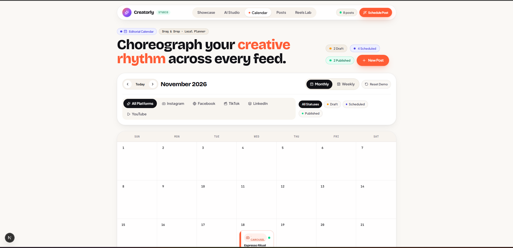
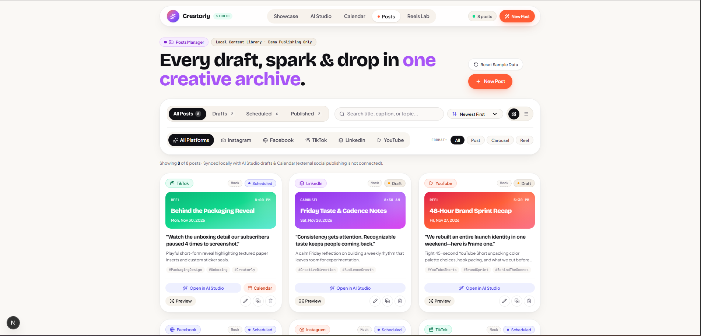

# Creatorly ✦
### Your Creative Space for Social Media

Creatorly is a modern social media creation and management platform designed to help content creators organize their workflow, create content, and manage their publishing plans through a creative and interactive experience.

## ✨ Features

- **Creative Home:** A visual workspace for creators.
- **AI Content Studio:** A dedicated space for content creation workflows.
- **AI Playground:** An experimental creative workspace.
- **Content Calendar:** Organize and plan social media posts.
- **Posts Manager:** Manage and organize saved posts.
- **Studio Lab:** Explore creative tools and content ideas.

## 🖼️ Screenshots

### Home


### AI Playground


### Spark Feed


### AI Content Studio




### Studio Lab





### Content Calendar


### Posts Manager



## 🛠️ Tech Stack

- Next.js
- React
- TypeScript
- Tailwind CSS
- Motion for React
- Lucide React

## 🚀 Getting Started

Clone the repository:

```bash
git clone https://github.com/alaaosamabakit/creatorly.git
```

Install dependencies:

```bash
npm install
```

Run the development server:

```bash
npm run dev
```

Open [http://localhost:3000](http://localhost:3000) in your browser.

## 📌 Project Status

Creatorly is currently under development. Some features use local storage or demonstration data, while advanced AI capabilities and external social media integrations are planned for future development.

---

**Built with creativity ✦**
